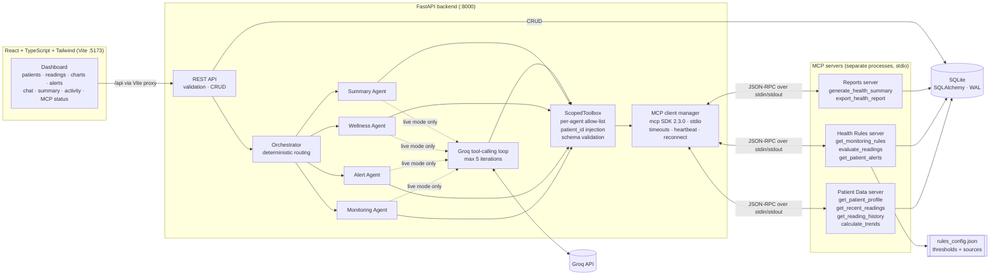

# AI Health Monitoring System — Educational Multi-Agent Demo

A runnable college/demo project: a React dashboard, a FastAPI backend with four specialised AI agents and an
orchestrator, and **three real MCP servers** connected over the **stdio** transport with the official
Model Context Protocol Python SDK. Groq is the LLM provider. Without a Groq key, every feature except
AI-written text works, using clearly labeled deterministic responses.

> ⚠️ **Educational tool, not a medical device.** All demo patients are synthetic. The system does not
> diagnose diseases, recommend medication, or claim clinical accuracy. Alert thresholds come from a
> documented config file, never from the LLM. No real wearable or device is connected; the simulator
> generates fake data and labels it everywhere.

---

## 1. Quick start

**Requirements:** Python 3.11+ (tested on 3.12.10) and Node.js 20+ (tested on 26.13.1).

```powershell
# Windows
start.bat            # or:  python start.py
```
```bash
# macOS / Linux
./start.sh           # or:  python3 start.py
```

On the first run, `start.py` will:
1. create `.env` from `.env.example`,
2. create `backend/.venv` and install the pinned Python packages,
3. run `npm install` in `frontend/`,
4. start the backend at http://127.0.0.1:8000 (API docs at `/docs`). On startup the backend seeds the
   synthetic database, launches the 3 MCP servers as subprocesses, and discovers their tools,
5. start the dashboard at **http://localhost:5173**.

`Ctrl+C` stops everything. Uvicorn runs its shutdown, which closes each MCP session and its subprocess.

Other options:

| Command | What it does |
|---|---|
| `python start.py --check` | Runs all backend tests and the frontend type-check/build, then exits |
| `python start.py --reset-db` | Wipes and reseeds the synthetic database, then starts |
| `python start.py --setup-only` | Installs dependencies only |
| `python start.py --backend-only` | Starts only the backend (and its MCP servers) |

## 2. Adding your Groq API key (exactly where)

1. Open **`.env` in the project root** (`ai-health-monitor/.env`). `start.py` creates it on the first run. You can also copy it from `.env.example`.
2. Fill in:
   ```ini
   GROQ_API_KEY=gsk_your_key_here
   GROQ_MODEL=openai/gpt-oss-120b
   DATABASE_URL=sqlite:///./health_monitoring.db
   DEMO_MODE=false
   ```
3. Restart (`Ctrl+C`, then `start.bat` again). The header badge changes from **"AI offline · rule-based"** to **"AI · openai/gpt-oss-120b"**.

No code changes are needed. Live mode needs **both** a key and `DEMO_MODE=false`. Otherwise the app stays in demo mode and the dashboard explains why.

**Model choice:** `openai/gpt-oss-120b`. As of Nov 2026, Groq's tool-use docs list it as supporting local tool use, and Groq's deprecation page names it as the replacement for retired models such as `llama-3.3-70b-versatile` (shut down Aug 2026). If `GROQ_MODEL` is empty, the backend uses this model. `openai/gpt-oss-20b` is a cheaper alternative. Check https://console.groq.com/docs/models if you change it.

**Key safety:** the key is read only by the backend (`health_core/settings.py`). It is never sent to the frontend (`/api/config` exposes only a `groq_key_configured: true/false` flag). It is never passed to the MCP server processes, and never logged. `.env` is in `.gitignore`.

## 3. Architecture



**Data path.** The REST API does plain CRUD directly on SQLite: create patients, store readings, list readings for charts, acknowledge alerts. **All agent analysis goes through MCP tool calls:** retrieval, trends, rule evaluation, summaries, and reports. The backend never imports the tool functions. It reaches them only through `tools/call` on a stdio session.

### Directory layout

```
ai-health-monitor/
├── start.py / start.bat / start.sh   # one-command launcher (manages backend + frontend)
├── .env.example                      # copy to .env; Groq key goes here
├── backend/
│   ├── requirements.txt              # pinned versions
│   ├── app/                          # FastAPI app, agents, orchestrator, MCP client, Groq loop
│   │   ├── main.py                   # REST API + lifespan (starts/stops MCP servers)
│   │   ├── mcp_client.py             # MCPManager: stdio connections, discovery, calls, timeouts
│   │   ├── tooling.py                # ScopedToolbox: allow-lists, patient scoping, validation
│   │   ├── llm.py                    # mode selection + Groq tool-calling loop
│   │   ├── agents.py                 # 4 agents (instructions, tools, demo + LLM paths)
│   │   ├── orchestrator.py           # routing and result combination
│   │   ├── seed.py / simulator.py    # synthetic data
│   │   └── activity.py               # agent activity log
│   ├── health_core/                  # shared domain logic used by the MCP servers
│   │   ├── models.py db.py units.py
│   │   ├── rules.py rules_config.json
│   │   ├── trends.py reports.py repository.py
│   ├── mcp_servers/                  # the three stdio MCP servers
│   ├── tests/                        # pytest suite (real MCP servers)
│   └── logs/                         # backend.log, mcp_<server>.log (git-ignored)
└── frontend/                         # React 19 + TS + Vite 8 + Tailwind 4 + Recharts
```

## 4. Agents

| Agent | Responsibility | MCP tools it may call |
|---|---|---|
| **Monitoring Agent** | Retrieves readings and describes changes over time. Does *not* judge abnormality. | `get_patient_profile`, `get_recent_readings`, `get_reading_history`, `calculate_trends` |
| **Alert Agent** | Runs the deterministic rules and explains the alerts they produce. Can never create or change an alert. | `get_monitoring_rules`, `evaluate_readings`, `get_patient_alerts` |
| **Wellness Agent** | General, non-personalised wellness information linked to observed data. | `get_patient_profile`, `get_recent_readings`, `calculate_trends` |
| **Summary Agent** | Readable summaries and downloadable reports. | `generate_health_summary`, `export_health_report`, `get_patient_alerts` |

Each agent has its own system instructions (in `app/agents.py`) on top of a shared safety preamble: no diagnosis, no medication advice, no invented thresholds, use only tool data. Each also has a **hard tool allow-list** enforced by `ScopedToolbox`. If an agent calls a tool outside its list, the call is rejected and logged. For example, the Wellness Agent cannot call `evaluate_readings`. Every agent has two paths:

* **Demo path (no key):** a fixed, deterministic sequence of MCP calls plus a template answer, labeled *"Demo assistant — deterministic template response (no AI model used)"*.
* **Groq path:** the tool-calling loop below, restricted to the agent's tools. If Groq fails, the agent falls back to the demo path, labeled *"Demo fallback — Groq request failed"*, and the error is shown.

**Orchestrator** (`app/orchestrator.py`):
* **Chat:** keyword routing picks 1–3 agents (e.g. "alerts" → Alert Agent, "summary" → Summary Agent, default → Monitoring + Alert). Each agent runs and the results are combined into labeled sections. If the question asks for a diagnosis or medication, a safety note is added.
* **New reading:** a deterministic pipeline (no LLM, even in live mode). The Monitoring Agent calls `get_recent_readings`, then the Alert Agent calls `evaluate_readings`.
* **Summary / report / alert explanation:** routed to the Summary or Alert Agent.

### Groq tool-calling loop (`app/llm.py::run_tool_loop`)
1. Send the agent's instructions, the conversation, and **only its allowed tools** to Groq. The tool schemas are the discovered MCP `inputSchema`s with `patient_id` removed and `additionalProperties:false`.
2. For each requested tool call: check the tool is allowed, parse the JSON arguments, validate them against the schema, reject any model-supplied `patient_id`, inject the active patient, and execute via MCP `tools/call`.
3. Return each result (or a structured error) to the model as a `tool` message.
4. Repeat until the model answers, for at most **5 iterations**. After that, one final call is made with tools disabled.

## 5. MCP integration details

* **SDK:** `mcp==2.3.0` (official Python SDK; in v2, `FastMCP` was renamed `MCPServer`). Servers use `MCPServer(...).run("stdio")`. The backend uses `mcp.Client` over `mcp.client.stdio.stdio_client`.
* **Startup:** `MCPManager.start()` spawns `python -m mcp_servers.<name>` for each server. It completes the protocol handshake (negotiated version 2026-07-28), calls `tools/list`, and records the discovered tools. The dashboard's MCP panel shows the real state of each connection: status, protocol version, tools, call and failure counts, and errors.
* **Validation:** arguments are validated twice: client-side against the discovered JSON Schema (`jsonschema`), and server-side by the SDK's pydantic validation (`patient_id ≥ 1`, `days 1–365`, `limit 1–500`, metric enums, format enum).
* **Failures and timeouts:** each call runs under a timeout (20 s default) and raises `MCPTimeoutError` (HTTP 504). Server-reported errors become `MCPToolError` (502). Transport failures mark the server as errored and trigger a reconnect. A heartbeat every 15 s detects dead servers, and the supervisor reconnects with exponential backoff. The heartbeat is a `tools/list` round-trip, because protocol 2026-07-28 removed `ping`. Killing a server process during the demo shows it reconnect within seconds. The panel's **Reconnect** button restarts the sessions.
* **Shutdown:** on backend shutdown each session is closed. The SDK closes stdin, waits, and then kills the process tree (a Job Object on Windows).
* **stdio hygiene:** stdout carries only JSON-RPC. Server logs go to stderr, which the backend redirects to `backend/logs/mcp_<server>.log`. The servers never `print`, and a test checks that stdout stays empty.
* **Scope and safety:** there are no SQL, file-path, or command parameters anywhere. `export_health_report` returns content, and the backend turns it into a download. `patient_id` always comes from the URL of the active patient. Results that mention any other patient are discarded (`PatientIsolationError`). The Groq key is not passed to the servers.

## 6. Alert rules (transparent and configurable)

* All thresholds live in `backend/health_core/rules_config.json`. Set `RULES_CONFIG_PATH` to use a different file. Each rule records its **metric, condition, severity, message, explanation, source, and limitations**. The file is validated at load, and malformed rules or unknown metrics are rejected.
* Severity levels are `info`, `warning`, and `critical`. Only the most severe rule per group fires for a reading. There is also one trend rule: weight change ≥ 2 kg within 7 days.
* **Sources used:** AHA resting heart rate (60–100 bpm); NHS pulse-oximeter guidance (≤ 94 % seek advice, ≤ 92 % urgent); CDC fever definition (≥ 38.0 °C); Mayo Clinic high-fever guidance (≥ 39.4 °C); CDC/Mayo hypothermia (< 35 °C); 2017 ACC/AHA BP categories (≥ 130/80, ≥ 140/90) and AHA hypertensive-crisis level (> 180/120); AHA/NHS low BP (< 90/60); CDC/AASM sleep (≥ 7 h). Some escalation levels are **project-chosen demonstration thresholds** and are labeled that way in the config (HR 130/40, sleep < 5 h, weight 2 kg/7 d).
* **Limitations:** rules are for adults at rest. They are not validated for children, pregnancy, athletes, or chronic conditions. They look at single readings and ignore symptoms, medication, and personal baselines. Consumer devices have accuracy limits, including pulse-oximeter bias on darker skin.
* **Rules vs. AI in the UI:** alert cards are tagged *"Rule-generated · <rule_id>"* and show the deterministic *Rule explanation* and source. An optional *"Explain (Alert Agent)"* result appears in a separate dashed box labeled as AI-written (or as a demo template). It is stored only if Groq produced it.

## 7. Tests and checks

Run `python start.py --check`, or run `cd backend && .venv\Scripts\python -m pytest -q` directly.

| File | Covers |
|---|---|
| `test_rules.py` | Every threshold boundary, most-severe-per-group, the trend rule, a custom config file changing outcomes, rejection of an invalid config, unit conversion (°F→°C, lb→kg), implausible-value rejection |
| `test_mcp_integration.py` | **Real stdio servers**: all 3 connect, all 9 tools discovered, every tool executed, client- and server-side validation, unknown tools, timeout plus recovery, reconnect, shutdown, stdout kept free of logs |
| `test_patient_isolation.py` | Repository scoping, `patient_id` hidden from model schemas and rejected if supplied, undeclared arguments rejected, per-agent tool allow-lists, foreign-patient results discarded, API ownership checks (404 for another patient's reading or alert) |
| `test_end_to_end_flow.py` | Add reading → retrieved via MCP → rules evaluated via MCP → alert visible → summary → report download; idempotent re-evaluation; readable validation errors; demo labeling; chat routing; safety note |
| `test_resilience.py` | **Resilience lab end to end** (real API + real MCP + real injection): edge discovery from allow-lists and the MCP manifest, applicability reasons, overrides, policy refusals naming the rule (never clamped), two-admin policy changes, approvals and segregation of duties, break glass, write-timeout absorbed by idempotent retry, guardrails off → watchdog rollback + findings → guardrails on → finding verified, malformed output (500 without contracts, graceful with them), stale data flagged, unexercised edge → inconclusive, dry run, abort by a viewer, kill switch, blackout windows, fault disable, starter suite + CI gate, per-journey scoring, audit hash chain tamper detection, unknown actors |
| `test_model_gateway.py` | Model-gateway faults with a stand-in LLM: provider error and empty answers fall back to the labelled deterministic answer; the blast radius limits which patients are affected |
| `test_tool_loop.py` | The Groq loop with a **scripted fake model** (no network): tool specs without `patient_id`, real MCP execution, rejection of patient switching, disallowed tools, bad JSON, and out-of-range arguments, the max-iteration cap, Groq-failure fallback, mode selection, the key never appearing in config output |

Tests use a temporary database and force `GROQ_API_KEY=""`, so they never use your key or your data.

## 8. Demo walkthrough (about 8 minutes)

1. **Start:** run `start.bat` and open http://localhost:5173. The header shows the AI mode and the tool-server status.
2. **Patients:** pick *Sam Okafor* (sample data; seeded fever and low-oxygen episode). The Overview tab shows each vital with its rule-based status and a trend chart with the warning threshold drawn.
3. **The core flow:** on **Readings**, enter Oxygen saturation **89 %** and save. The pipeline card shows Monitoring Agent → `get_recent_readings` → Alert Agent → `evaluate_readings` → a new **Critical** alert.
4. **Alerts / Assistant / Reports / System** tabs: rule explanations and sources, the multi-agent assistant with the safety note, summary + report export, MCP servers and the agent activity log.
5. **Resilience lab** (header switch): *Overview* shows journey scores and untested critical edges; *Topology* shows every agent → tool edge and why each fault does or does not apply.
6. **Experiment:** *Journeys → Reading ingestion → Generate starter suite*. Act as `devon.sre` (sidebar) and approve the write-path experiment, then act as `morgan.author` and run it. Watch the live run: baseline → inject → recovery, steady state vs baseline, cascade, event log.
7. **Break it on purpose:** act as `jordan.admin`, turn off *Settings → Guardrails → retries*, and run a timeout experiment at 100 %. The watchdog rolls back, findings appear with recommended guardrails. Turn retries back on, re-run at 50 %: the hypothesis holds and the finding is marked verified.
8. **Safety:** press **Kill switch** as any role (even `riley.viewer`), see runs stop; only a tenant admin can release it. *Settings → Audit log* shows every step in a verified hash chain.
9. **CI gate:** `cd backend && .venv\Scripts\python -m app.resilience.cli run-suite --suite 1 --wait-for-window` exits 0 when the gate passes and 1 when it blocks.
10. **(With a key)** Set `DEMO_MODE=false` and restart. Answers become AI-generated, and model-gateway faults (provider error, latency, degradation) become available in the lab.

## 9. Configuration reference

| Variable | Default | Meaning |
|---|---|---|
| `GROQ_API_KEY` | empty | Groq key; backend only |
| `GROQ_MODEL` | `openai/gpt-oss-120b` when empty | Any Groq chat model with tool use |
| `DATABASE_URL` | `sqlite:///./health_monitoring.db` | SQLite only. Relative paths resolve against `backend/` so all processes share one file |
| `DEMO_MODE` | `true` | `false` plus a key enables Groq |
| `RULES_CONFIG_PATH` | `backend/health_core/rules_config.json` | Alternative rules file |
| `RESILIENCE_ENV` | `dev` | Which blast-radius policy column applies (`dev`, `staging`, `production`) |

## 10. Known limitations

* Single-user local demo: there is no authentication. "Active patient" scoping protects against model and tool misuse, not against a malicious user of the API.
* Chat routing is keyword-based (transparent, but simple).
* The trend direction is a linear-slope heuristic, not a statistical test.
* Live Groq responses depend on the model; the safety instructions reduce risk but cannot guarantee output quality.
* Resilience-lab identity is asserted with an `X-Actor` header and a local directory (no SSO); it enforces segregation of duties inside the app but is not authentication.

## 11. Resilience lab (chaos experiments)

A fault-injection console modelled on the NaviStorm wireframes, applied to this product's own agents, MCP tools and model. Everything runs locally; no extra services or packages.

| NaviStorm concept | Here |
|---|---|
| Agents → tools → systems | 4 agents → 9 MCP tools on 3 stdio servers, plus the Groq model gateway (17 edges) |
| Edge discovery | Agent allow-lists + MCP `tools/list` manifest (`read_only_hint`, `idempotent_hint`) + response-shape sampling of read-only tools |
| Journeys with SLOs | Reading ingestion & alerting · Assistant Q&A · Summary & report · Alert explanation (`app/resilience/journeys.py`) |
| Sites in scope | Patients in scope. Sample patients are the sandbox; user-created patients are protected outside dev |
| MCP proxy / model gateway | `ScopedToolbox.call` (every agent tool call) and a wrapper around the LLM client |
| Fault library | `app/resilience/fault_library.json` — 13 faults; data drives applicability, the builder form and policy |
| Blast-radius policy | Versioned ceilings per environment, write-path and protected-patient rules, blackout windows; refused with the rule named, never clamped; two tenant admins to publish |
| Roles & approvals | Author / SRE / product owner / tenant admin / auditor / viewer / CI service; approvals bound to an experiment version, expire in 24 h; no self-approval; break glass for admins |
| Live run | Baseline → inject → recovery, watchdog rollback on abort-flagged breaches or lost telemetry, abort by anyone who can view, tenant kill switch (fail open) |
| Findings & score | Deterministic findings with recommended guardrails, deduplicated, verified by later passing runs; documented score formula |
| Suites & CI | Starter suites per journey, gate on the journey score, `python -m app.resilience.cli run-suite` (exit 0/1/2), `--wait-for-window` |
| Audit log | Append-only, gapless, SHA-256 hash-chained; verify, CSV/JSON export |

**Score formula.** Run = 100 × (0.7 × share of fault iterations where every steady-state check held + 0.3 × recovered), capped at 49 when rolled back. Journey = sum of edge scores ÷ edges with an active interception point (untested edges count as 0); runs only count for the journey they ran under.

**Guardrails the experiments verify** (Settings → Guardrails, admin only, audited): bounded retries with backoff, jitter and retry-after for tools the manifest declares idempotent; output contracts on every tool result, plus falling back from empty model answers.

**Experiment data** (readings written by the ingestion workload and the alerts they raise) is removed when a run ends, and on the next startup if a run was interrupted.

**Limits.** Faults are injected in-process, so network-level effects and real server crashes are not reproduced (use Tool servers → Reconnect for the real reconnect path). In rule-based mode the model gateway carries no traffic, so model faults and model-only tool edges are unavailable or inconclusive until a Groq key is configured. Combined-fault scenarios are not supported.
